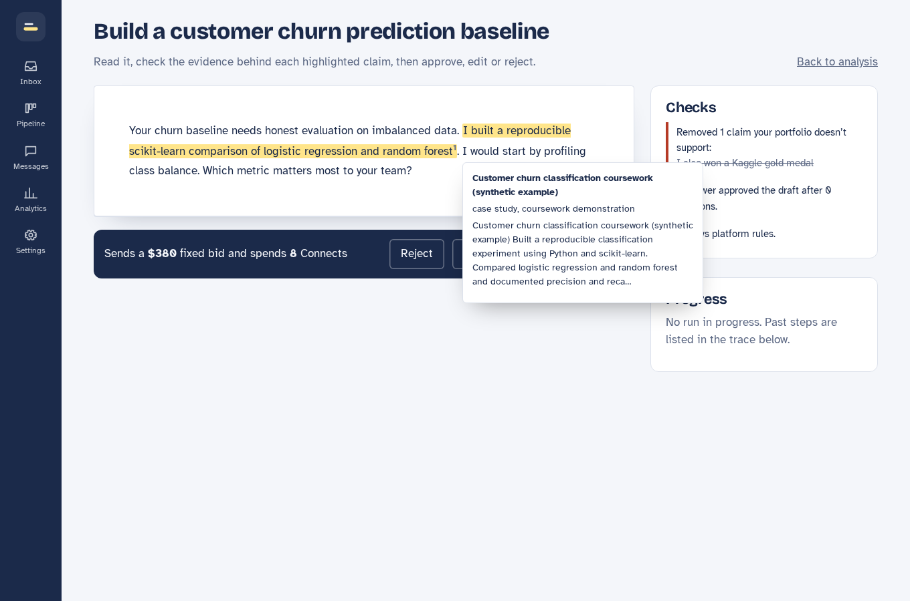

# GigBid

A team of AI agents that finds freelance jobs, flags the risky ones, and drafts proposals where every claim is
backed by your own portfolio. Nothing is sent until you approve it.



**Live:** TODO-your-url · **Demo video:** TODO · **Write-up:** TODO · **Traces:** TODO (3 LangSmith links)

## How it works
Scout → (Job Analyst ‖ Risk Assessor ‖ Fit Matcher) → bid/skip → Pricing → Writer → claim verification → Critic
(max 2 revisions) → Compliance Guard → **your approval** → marketplace draft. Client replies go through a
Client Liaison graph with the same approval gate. Details: [docs/ARCHITECTURE.md](docs/ARCHITECTURE.md).
What is done and what is left: [docs/STATUS.md](docs/STATUS.md).

## Run it

**1. Install** (Python 3.11+, Node 22):
```
python -m venv .venv
.venv\Scripts\activate            # Windows   (macOS/Linux: source .venv/bin/activate)
pip install -e ".[dev]"
cd apps/web && npm ci && npm run build && cd ../..
```
**2. Keys:** `.env` is already there with every secret generated. Open it and paste your key after `LLM_API_KEY=`
(free at console.groq.com) and `LANGSMITH_API_KEY=` (free at smith.langchain.com). To recreate it: `python scripts/setup_env.py`.

**3. Embeddings:** install Ollama, then `ollama pull nomic-embed-text`.

**4. Start:** `python -m uvicorn apps.api.main:app --port 8000` and open http://localhost:8000.
Sign in with the reviewer login from `.env` (`REVIEWER_EMAIL` / `REVIEWER_PASSWORD`).

No key yet? `python -m tests.demo_server` runs the whole app with a scripted model and sample data.

**Everything in Docker:** `docker compose -f infra/docker-compose.yml --env-file .env up --build`

## Tests
`pytest -q` (unit, MCP, contract, graph, crash-and-resume) · `cd apps/web && npx playwright test` (5 UI flows)

## Results (GigSim-lite substitute dev set, not the instructor's)
The instructor's GigSim and dev set were not in the starter kit, so these come from the student-built stand-in
(`simulator/`, labels from written rules in `simulator/generate.py`). Embeddings: bge-small via fastembed (CPU).

| Variant | Evidence Recall@5 | nDCG@10 | MRR |
|---|---|---|---|
| v0_naive | 0.2137 | 0.5287 | 0.8816 |
| v1_decompose | 0.0973 | 0.2763 | 0.506 |
| v2_hybrid | 0.0783 | 0.2148 | 0.4238 |
| v4_outcome | 0.006 | 0.0293 | 0.0535 |

Source: `evals/results/rag_retrieval.json` (600 jobs). **Finding:** the naive baseline wins here. Per-requirement
and BM25 retrieval pull in past proposals that name the same skills, crowding out the case studies that count as
proof; outcome-aware boosting makes that worse. Next experiment: restrict proof retrieval to case studies, repos and code.

Bid graph with the real open models (Groq gpt-oss-20b/120b), **8 dev jobs only** (`evals/results/decisions_real_smoke.json`):
bid/skip F1 0.8571, price in fair band 0.6667, unsupported claims before verification
0.1111, p95 53.838 s per job, $0.004 per proposal.
No scam happened to be in this sample. Too small to conclude; run more on later days (free tier: 200k tokens/day).
